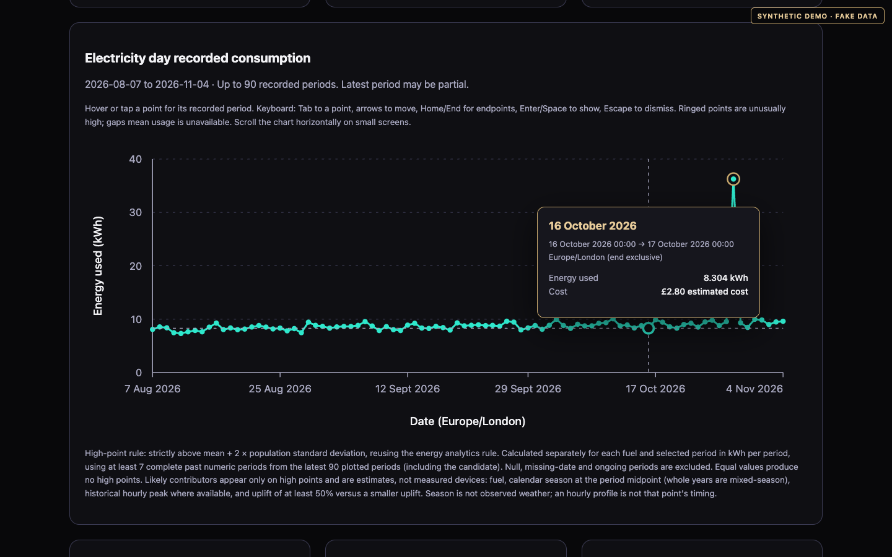
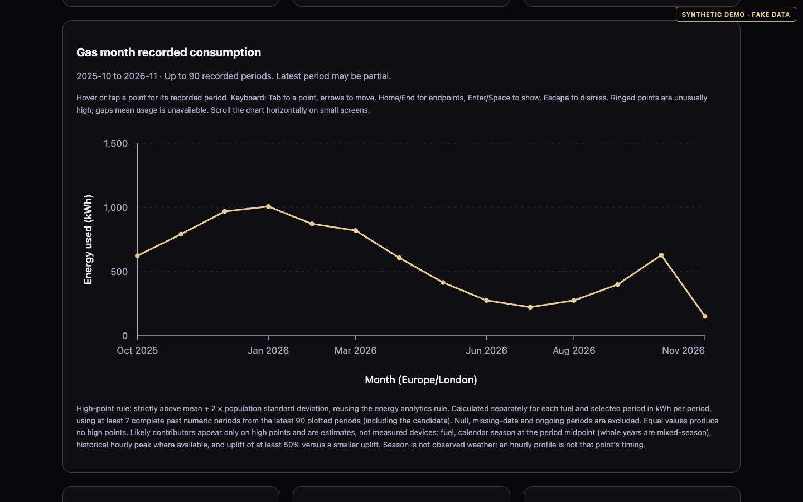
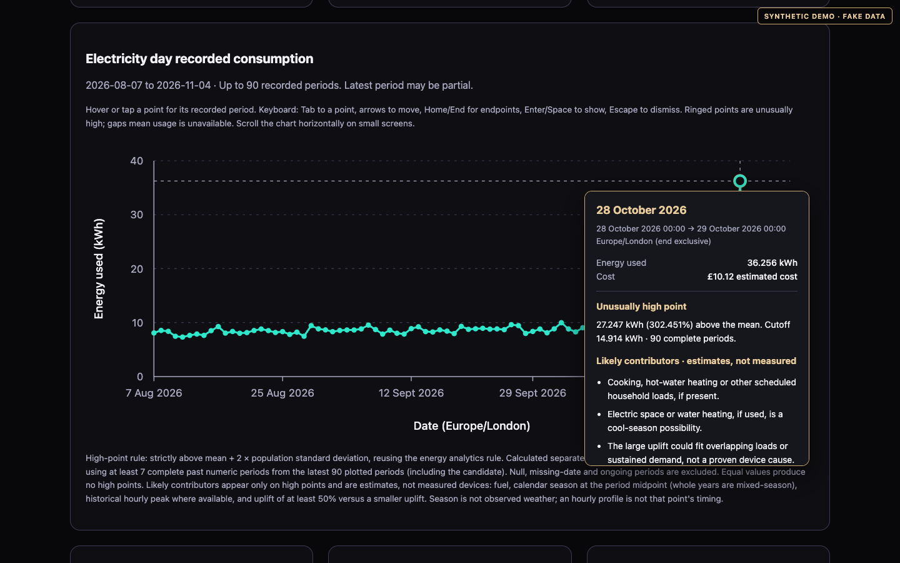
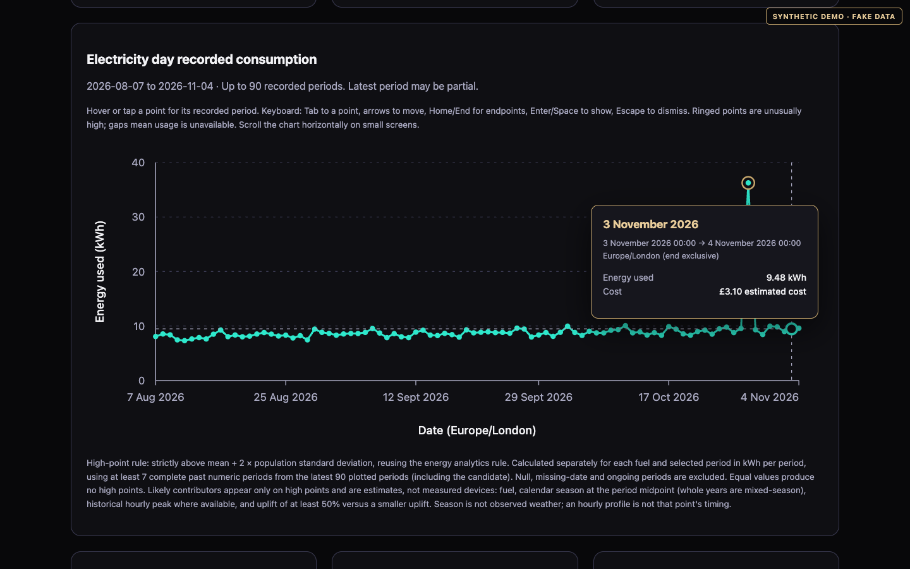
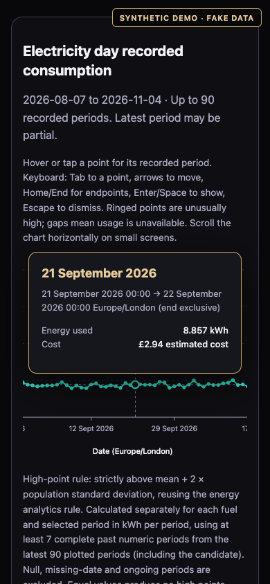

# Octopus Energy insights

This package turns my Octopus Energy smart-meter data into answers I can act on:

- **How much gas and electricity did I use, and what did it cost?** Daily, weekly, monthly and yearly.
- **Which days were most expensive, and was anything unusual?**
- **How much do I use overnight while everything should be idle?** A high overnight baseline usually means something is left on.
- **When is my peak hour, and what should I move?** For example, shifting laundry or EV charging out of the peak, into a Power Up / Happy Hour slot, or away from a Power Down event. Octopus event times aren't fetched; check them in the Octopus app.

It only **reads** from Octopus. It never switches tariffs, changes account settings or controls appliances. Smart meters measure the whole home, so it never claims to know what individual appliances used.

Want to try the chart without an account or API key? [Use the synthetic demo](#try-it-with-demo-data).

## Quick start

Requires **Python 3.10+**, a modern browser with JavaScript, and internet access for a real Octopus sync. There are no third-party Python runtime dependencies. Run all commands from the **repository root**; check `python3 --version` first. Node 22 and pinned Ruff are needed only for the automated checks below.

1. Create a local configuration without replacing an existing one:

   ```sh
   test -e .env || cp .env.example .env
   ```

   Edit `.env` with your own values and add the gas setting:

   ```dotenv
   ACCOUNT_NUMBER=your-octopus-account-number
   API_KEY=your-octopus-api-key
   GAS_UNITS=unknown
   ```

   Find the account number in your Octopus account and generate a key in its API access section. Never commit or share `.env`.

2. **Confirm gas source units before enabling gas estimates.** Identify the gas meter in your account, then confirm the units used by its API consumption readings with Octopus' API documentation or support. The physical meter display may show volume even when API readings are already kWh. A meter model alone is not confirmation. Leave `GAS_UNITS=unknown` if unsure; use `kwh` only for confirmed kWh readings. This tool does not convert cubic metres or cubic feet.

3. Collect readings, rates, reports and the dashboard:

   ```sh
   ./scripts/start-energy.sh --days 90
   ```

   For confirmed gas kWh, set `GAS_UNITS=kwh` locally or add `--gas-units kwh` to that command. Omit `--days` for the default 400-day first-run window.

4. Serve **only** the generated dashboard directory over loopback:

   ```sh
   python3 -m http.server 8765 --bind 127.0.0.1 --directory reports/energy/dashboard
   ```

   Open `http://127.0.0.1:8765/`. Stop the foreground server with Ctrl-C. Opening `index.html` using `file://` does not reliably load its JSON. Never serve the repository root, `.env`, SQLite databases or private reports.

## Try it with demo data

The [demo generator](../scripts/energy-demo-data.py) creates 400 days of fictional readings and tariffs for both fuels, including unusually high days. It needs no credentials, never reads `.env` and makes no provider requests.

From the repository root, using Python 3.10+:

```sh
python3 scripts/energy-demo-data.py --database /tmp/energy-demo.sqlite3 --output-dir /tmp/energy-demo-dashboard --seed 2026 --end-date 2026-11-04
python3 -m http.server 8765 --bind 127.0.0.1 --directory /tmp/energy-demo-dashboard
```

Open `http://127.0.0.1:8765/` and look for **SYNTHETIC DEMO · FAKE DATA**. The SQLite file stays outside the served directory. Stop the server with Ctrl-C before reusing its port.

Keep these separate demo paths: generated files in the output directory are replaced, so never point it at real reports. To regenerate an existing demo, add `--force` to the generator command. It verifies the demo marker and exact fake identities again under a database write lock, refusing mixed or real data even if an old demo marker remains.

The seed and end date reproduce the fake readings, not export timestamps. This fixed historical end date can produce stale-reading warnings later; that is expected. Longer-period views may have too few complete periods for a high-point assessment.

## Screenshots

These screenshots contain only synthetic data. Google Fonts was blocked during capture, so fallback fonts are shown.



Synthetic electricity by day, with date/kWh/estimated-cost hover tooltip.



Synthetic gas by calendar month (Europe/London); the latest month may be partial.



Synthetic high day with “Likely contributors · estimates, not measured”.



Keyboard-selected point; Tab enters, arrows/Home/End move focus.



Mobile tap with chart-only horizontal scrolling.

## How to test the dashboard

- [ ] Switch both fuels through daily, weekly, monthly, yearly and **Latest day**, ten combinations. Check the labelled period axis in Europe/London and the energy axis in kWh. Weeks start on Monday.
- [ ] Latest day selects the most recent complete past London day separately per fuel and plots 23, 24 or 25 real hourly buckets. Autumn's repeated hours keep distinct BST/GMT offsets. Hourly cost excludes standing charge; missing usage or unit rates remain unavailable.
- [ ] Hover or tap a numeric point. Its crosshair and tooltip show the recorded period's date/time range, usage and estimated cost, not an individual device's operating time.
- [ ] Use Tab to reach a point, arrow keys to move, Home/End for endpoints, Enter/Space to show the tooltip and Escape to dismiss it.
- [ ] Inspect a ringed high point when enough complete history exists. Contributor hints are **estimates, not measured appliances**. The rule needs at least seven complete past numeric periods and flags values strictly above mean + 2 population standard deviations; ongoing, missing-date and null periods are excluded.
- [ ] Check incomplete-pricing and unknown-gas states: available usage can remain numeric while cost is unavailable; unknown usage is a gap, never invented zero use. The Node suite below exercises these states and stale-data warnings.
- [ ] Check freshness labels separately: meter readings older than 48 hours or exports older than 24 hours warn. The automatic five-minute reload fetches only the published snapshot, never Octopus.
- [ ] After loading a snapshot, stop the preview server and press **Fetch latest data**. The existing chart should remain readable with a safe refresh failure, not a fabricated successful update. Restart the server to recover snapshot loading.
- [ ] On a configured HTTPS/PHP deployment, press **Fetch latest data** and check pending/running/success or a safe failure state. Repeated requests coalesce or show a cooldown; the chart retains its last good data. A plain static preview cannot execute PHP and must report refresh as unavailable, not claim success.
- [ ] On a narrow/mobile screen, tap points, scroll the chart horizontally and check that tooltip content is readable. Repeat keyboard navigation on desktop.

Historical peak hours are averages across available readings, not that point's measured timing or a cheapest-rate prediction. Event invitations are not fetched; confirm them in your Octopus account. Seasonal hints use calendar season, not observed weather.

### Automated checks

With Node 22 installed, create a test environment outside the checkout and run:

```sh
python3 -m venv "$HOME/.venvs/personal-ai-energy-checks"
. "$HOME/.venvs/personal-ai-energy-checks/bin/activate"
python3 -m pip install "ruff==0.16.10"
python3 -m unittest discover -s tests -v
python3 -m ruff check .
python3 -m ruff format --check .
node --test tests/dashboard.test.js
node --check octopus_energy/dashboard.js
php -l octopus_energy/refresh.php
```

## Collection and gas settings

Later consumption syncs reread seven days before each meter's newest stored reading, clamped to `--days` unless its watermark is older. Upserts prevent duplicates. Increasing `--days` later does not automatically extend earlier consumption history. Historical tariff agreements are checked; rate downloads also use the requested window.

Gas precedence is `--gas-units` > process `GAS_UNITS` > `.env` `GAS_UNITS` > `unknown`. Successful CLI runs apply and store that resolved mode, so an **unconfigured successful run reverts gas to unknown**, even after a kWh run. Report-only calls without a mode preserve the stored setting; MCP reads it without changing it. Failed or incomplete collections preserve the previous snapshot and mode. Raw readings are retained when estimates are recomputed.

Missing required tariff coverage makes costs unavailable, never zero. Estimates cover retrieved intervals, not necessarily complete billing days, and are not reconciled bills. See `python3 -m octopus_energy.cli --help` for `--database`, `--env-file`, `--report-dir` and `--dashboard-dir`.

## Outputs and privacy

| Output | Contents |
| --- | --- |
| `reports/energy/YYYY-MM-DD.md` | Tariffs, available usage/cost estimates, overnight baseline and unusual days |
| `reports/energy/monthly-cost-analysis.md` | Highest-cost fully priced days, including one standing charge per evidenced supply point |
| `reports/energy/dashboard/index.html`, `data.json` | Interactive dashboard and aggregate snapshot |
| `reports/energy/dashboard/status.json`, `refresh.php` | Safe refresh state and the protected request endpoint (private directory rendered only during publication) |
| `data/octopus_energy.sqlite3` | Local readings, rates, unit settings, derived costs and sync history |
| `data/energy-refresh/` | Git-ignored private config, request flags and rotating operational log; never served |

Real generated data is Git-ignored. Dashboard JSON omits account numbers, meter points and serial numbers, but household totals are still private. Only synthetic documentation assets may be committed.

The theme loads Google Fonts, sending normal browser request metadata such as IP address and site origin, not energy readings. Local fallback fonts work if that request is blocked.

## Deployment

After explicit approval, a successful GitHub `Test` run for `main` can trigger the configured, protected deployment. This source's gas readings were confirmed as kWh, so the refresh runner uses `./scripts/start-energy.sh --days 90 --gas-units kwh`. Other accounts must verify their units before opting in.

### Scheduled and on-demand refresh

The approved deployment installs exactly one `# personal-ai-energy-refresh` cron entry. It checks every minute, but only collects when due (60 minutes by default), forced by a deployment, or requested through the website. Set the optional GitHub Actions variable `ENERGY_REFRESH_INTERVAL_MINUTES` to a positive integer and deploy a tested change to alter the interval.

Deployment writes only these non-secret settings to `APP/data/energy-refresh/config.json`:

```json
{"DASHBOARD_TARGET": "/absolute/protected/directory", "ENERGY_REFRESH_INTERVAL_MINUTES": 60}
```

The directory is mode `0700`; config and request flags are `0600`. It stays outside the web directory and contains no API key. `.env` remains in the private application checkout. Unavailable `crontab` fails deployment rather than pretending scheduling succeeded, and unrelated cron entries are preserved.

The website's **Fetch latest data** button sends a same-origin, authenticated HTTPS POST. PHP only creates a private flag, never launches a command or contacts Octopus. The flag contains only a random 32-character lowercase hexadecimal request ID, published from a private temporary file using an atomic hard link. Flags and their temporary files stay `0600` inside the ignored private directory. The next available cron tick consumes the request. Pending/running requests coalesce and a five-minute cooldown limits repeated requests.

`status.json` always includes `request_id`, either the claimed request's 32-character ID or `null`. Pre-claim and scheduled attempts use `null`. The browser matches the acknowledged ID to status, so an earlier attempt cannot falsely complete a newly queued request. A retained retry is served before a newer queued request, which remains pending until its own ID is claimed. This ID correlates work; it is not a credential or a household identifier. A queued request is not a completed sync, and Octopus may still return delayed readings.

Cron, deployment and manual refresh share a single-flight lock. After deployment has installed its config, an authorized operator can run `./scripts/refresh-energy.sh --force` from the private application checkout. Do not run the cron installer just to test locally; its tests use a fake crontab.

Full publication stages `refresh.php`, `data.json`, `index.html` and `status.json`, then replaces them in that order, status last. Failure rolls back prior files; a distinct partial-publication failure retains recovery backups if restoration itself fails. `--status-only` validates and atomically updates only status, preserving the chart snapshot. The publisher never edits `.htaccess` or publishes `.env`.

Normal browser reloads still only fetch the published snapshot. Refresh status separates last attempt, last successful publication and latest readings for each fuel; safe failures retain the last good chart. PHP must execute on the protected HTTPS site; a static preview cannot perform a source refresh. Website authentication is separate from the Octopus API key. Green skipped jobs do not prove freshness.

CI verifies its PHP runtime and runs PHP endpoint tests without allowing a missing-PHP skip. Local Python suites may skip those tests when PHP is absent; install PHP to exercise them. See [deployment operations](../docs/energy-dashboard.md) and [dated readiness evidence](../docs/energy-readiness.md).

## Using it from an AI assistant (MCP)

`mcp_server.py` is a read-only Model Context Protocol server that communicates over stdio, so an AI assistant can query the local database:

```sh
python3 -m octopus_energy.mcp_server [path/to/octopus_energy.sqlite3]
```

| Tool | Returns |
| --- | --- |
| `get_energy_summary` | Available usage and estimated cost per fuel, optionally bounded by `start` and/or `end` |
| `get_daily_consumption` | Daily usage and cost between `start` and `end` |
| `get_monthly_bill_comparison` | Usage and cost per month and fuel |
| `get_tariff_details` | Stored tariff code and validity per fuel |
| `get_expensive_days` | Most expensive days (`fuel`, `limit`) |
| `get_overnight_baseline` | Average overnight usage per fuel |
| `detect_energy_anomalies` | Days unusually far above normal |
| `get_savings_recommendations` | Stored savings recommendations (none are generated yet) |

There are no mutation tools. Initialization, discovery and calls use standard MCP stdio messages. Database queries open SQLite read-only and return safe errors without exposing paths, payloads or credentials. An old derived-cost schema requires a local collector/report refresh before queries become available; the MCP tool never migrates it.

## Code map

| File | Role |
| --- | --- |
| `cli.py` | Entry point. Runs the incremental sync, then reports and dashboard |
| `client.py` | Read-only Octopus REST client (HTTPS Basic auth, paginated) |
| `storage.py`, `schema.sql` | SQLite schema and batched upserts |
| `analytics.py` | Daily costs, expensive days, anomalies and overnight baseline |
| `reports.py` | Markdown reports |
| `dashboard.py` | Dashboard HTML and `data.json` |
| `refresh.py`, `refresh.php` | Single-flight source runner, safe status contract and flag-only web endpoint |
| `publisher.py`, `refresh_install.py` | Protected transactional publication and private config/marked cron installation |
| `mcp_server.py` | Read-only MCP tool server |

The guardrails for the AI energy analyst are in [`agents/energy-analyst.md`](../agents/energy-analyst.md).
